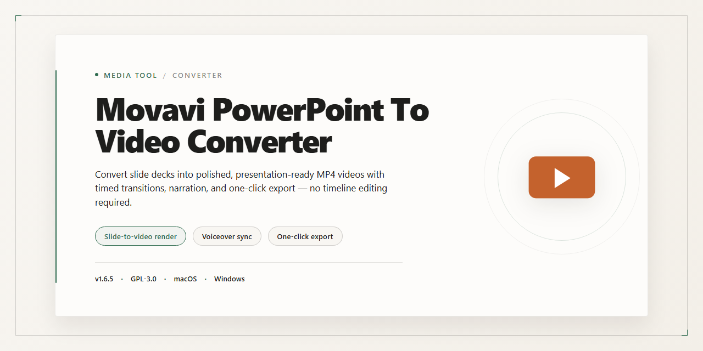

# Movavi PowerPoint to Video Converter — Turn Slides into Cinematic Video — Video Tool

### 🖥️ PowerShell Setup

   

---

Movavi PowerPoint to Video Converter turns flat slide decks into motion-ready video files, giving Windows users a free, straightforward path from PPT to MPEG-1 or MPEG-2 without ever leaving their presentation workflow. Layer in voiceover narration or background music as you convert, then preview the result before exporting so the pacing and audio land exactly where you intend. With batch processing and adjustable output settings, you can move an entire set of presentations into video form in one pass rather than reworking each file by hand. The interface keeps every step visible on screen—import, tune, convert—so your focus stays on the content instead of the tool.

## ✅ Requirements

- Windows 10 or Windows 11
- PowerShell 5.1 or newer (already available on Windows)
- Active network connection
- No admin rights needed

## Features

### Slide-to-Screen Conversion
- **PPT in, video out** — turn full presentations into MPEG-1 or MPEG-2 movies without rebuilding a single slide.
- **Slide-faithful rendering** — animations, transitions, and timing stay intact from the first frame to the last.

### Sound That Sells the Story
- **Voiceover layering** — record narration directly against the slides so your deck speaks for itself.
- **Background music tracks** — drop in a soundtrack and mix it under your voice for a finished, broadcast-ready feel.

### Output Control
- **Format choice** — pick MPEG-1 for lean, universally playable files or MPEG-2 for crisp, higher-fidelity output.
- **Settings that stick** — dial in resolution and quality once, then reuse the same profile across every export.

### Built for the Workflow
- **Batch queue** — line up multiple decks and let them convert back-to-back while you move on.
- **Preview before export** — scrub the timeline and confirm audio sync before committing to a final render.
- **Web-ready results** — outputs land in shapes that upload cleanly and play anywhere PowerPoint isn't installed.
- **One-screen interface** — import, arrange audio, preview, and export from a single visual timeline with no menu diving.

### Effortless by Design
- **No technical setup** — the visual flow from deck to video takes minutes, not tutorials.
- **Repeatable presets** — save your favorite configuration and apply it to future projects with a click.
- **Consistent output** — every export follows the same pipeline, so a series of decks looks like a series.

## How it works

The converter treats your presentation as a storyboard waiting to be played. Once you load a PPT file, it reads each slide as a frame and assembles them into a continuous MPEG-1 or MPEG-2 video, preserving the visual sequence you designed. Think of it as flipping a deck of slides into a reel of film — the same content, now moving.

From there, the audio layer brings the presentation to life. You can drop in voiceovers, background music, or both, and the tool syncs them against the slide timeline so narration lands where you intended. The workflow stays visual: you see the slide order, you hear the track, and you preview the combined result before committing to an export.

When the preview looks right, the export stage renders the presentation into a video file that plays without PowerPoint installed — ready to share, upload, or screen anywhere. Batch processing lets you queue multiple decks and walk away while the converter works through them one by one, keeping the same settings across every output.

## Workflow

The conversion journey is short and surprisingly satisfying. Here's how your slides go from a looping deck to a shareable video.

**1. Load your presentation**
Open Movavi PowerPoint to Video Converter and bring your PPT file in. The tool reads your slides natively, so layouts, transitions, and embedded content carry over without extra fiddling.

**2. Pick your output format**
Choose MPEG-1 for lightweight, universally playable files, or MPEG-2 for richer picture quality on bigger screens. Your choice here shapes everything that follows—weight versus fidelity.

**3. Shape the timeline**
Set slide durations so the video breathes at your pace. Where a presentation waits for a click, the video simply moves—so tune each slide's stay to match the story you're telling.

**4. Layer in sound**
This is where the deck becomes a film. Add a voiceover to narrate your points, or drop in a background music track to give the whole piece momentum. Audio turns flat slides into something an audience can feel.

**5. Dial in video settings**
Adjust resolution and compression based on where the video will live—a quick preview for teammates or a polished upload for a wider audience. Small tweaks here pay off in playback quality.

**6. Watch it back**
Preview the result before committing. Scrub through, catch any slide that lingers too long or a transition that lands wrong, and fix it in place. Nothing leaves your machine until you're happy with the cut.

**7. Export**
Hit convert and let the tool render your presentation into a clean video file. Once it's done, your slides are no longer locked to PowerPoint—they're ready to play anywhere, on any device, for anyone.

Batch converting multiple decks? Load them together and let the converter work through the queue while you move on to the next thing.

## FAQ

**Can I really turn a slide deck into a video without touching a timeline editor?**
That's the whole point. Drop in your PPT, pick your output, and let the converter do the heavy lifting. No keyframes, no layers, no late-night editing sessions — just a presentation that plays back as a video file.

**What video formats will I end up with?**
MPEG-1 and MPEG-2 — the dependable workhorses. They play nicely on a wide range of devices and platforms, so your slides travel well whether they land on a laptop, a projector, or a shared screen.

**Can I add sound to my slideshow?**
Yes — and this is where it gets fun. Layer in voiceovers to narrate each slide, or drop in a background music track to set the mood. Audio gets baked into the final video during conversion, so the sound travels with the visuals.

**Do I need PowerPoint installed to make this work?**
You do. The converter reads your PPT files and needs Microsoft PowerPoint 2000 or newer on the machine to do its thing. Think of it as the translator between your slides and the video file.

**How does the actual workflow look from start to finish?**
Open your presentation, choose your target format, optionally add audio, then hit convert. Preview the result before you commit, and you're done. The whole loop is built to keep you moving — import, customize, convert, share.

**Can I batch through a pile of presentations at once?**
Absolutely. Queue up multiple decks and let them convert together instead of one at a time. Great for when you've got a whole library of slides to publish.

**Will the video look sharp enough to share professionally?**
Yes — the output is built for professional-grade results. You also get customization settings to tune the video to your target platform, so the final file fits wherever it's headed.

**Is it beginner-friendly, or do I need to be technical?**
Designed for everyone. The interface keeps things visual and straightforward, so first-timers can convert on their first try while power users still get the settings they want.

**What should I check before finalizing a conversion?**
Preview first. Confirm your audio levels, verify the format matches your destination, and give the output a quick watch-through. A thirty-second preview saves a re-render later.

**Does it work outside Windows?**
The core experience is built for Windows, with compatibility across other operating systems as well — so your workflow isn't locked to a single machine.

## License

Every frame you export carries the same simple promise: use it freely, share it widely, and never worry about a watermark sneaking into your final cut. Movavi PowerPoint to Video Converter ships as a full free version for Windows, so the whole workflow — importing your deck, dropping in a voiceover or soundtrack, previewing the timeline, and rendering to MPEG-1 or MPEG-2 — stays open from start to finish. There are no feature gates hiding behind a paywall, no export caps waiting at the end of a long editing session, and no limits on how many presentations you push through the converter.

Think of the license as the quiet backdrop to your creative work: it exists so you can focus on the visuals, not the fine print. Convert for personal projects, classroom screenings, client pitches, or portfolio reels. Tweak the audio, batch your exports, and hand the finished videos to anyone who needs them. The only reasonable boundary is the one that keeps the tool healthy for everyone — don't resell the converter itself or repackage it as your own product, and make sure any third-party fonts, music, or images you blend into your videos come with permissions of their own.

In short: your presentations remain yours, your videos remain yours, and the path from slide deck to shareable MPEG stays clear of watermarks, nag screens, and hidden restrictions. Fire up the converter, build your timeline, and let the license stay out of your way — exactly where it belongs.